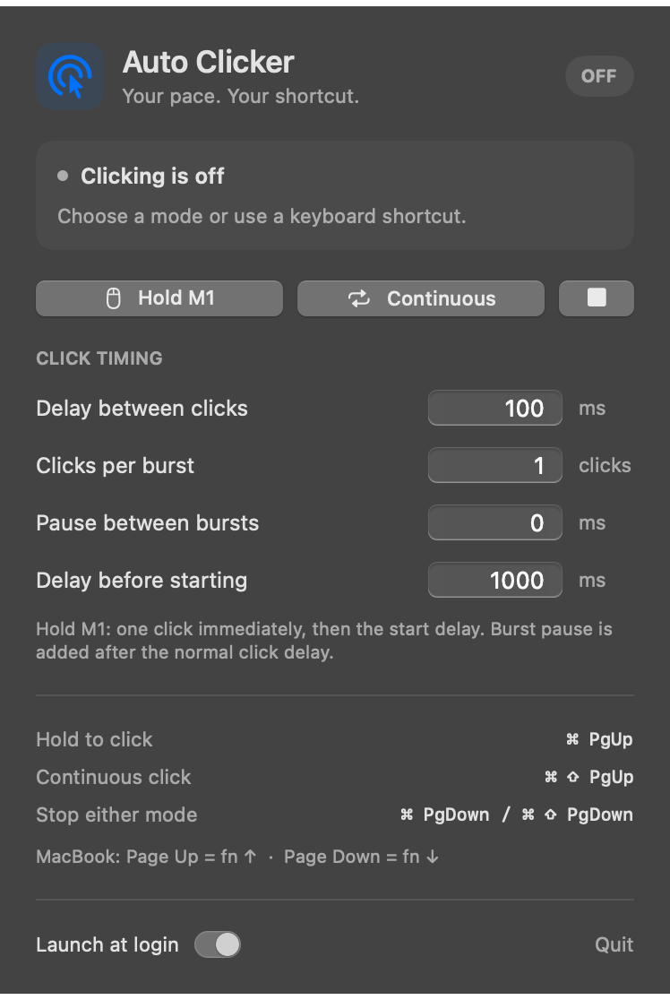

# Auto Clicker for macOS

[](https://github.com/RealPotsOK/autoclicker/actions/workflows/macos.yml)

A native menu bar auto clicker with hold-to-click and continuous modes, global keyboard shortcuts, configurable bursts, and launch at login. Built with Swift, SwiftUI, and AppKit, with no third-party dependencies.



## Features

- **Hold to click:** press M1 for one immediate click, then keep holding to repeat after your chosen start delay.
- **Continuous clicking:** repeat without holding the mouse button.
- **Normal double-clicks and triple-clicks** while hold mode is armed.
- **Custom timing:** click delay, clicks per burst, pause between bursts, and start delay.
- **Global start and stop shortcuts**, plus quick controls in the menu bar.
- **Launch at login** and automatically saved settings. Clicking starts off each time the app opens.

## Requirements

- macOS 13 Ventura or later.
- Apple's Swift command line tools or Xcode to build from source. Use a Swift 6 or later toolchain for the tests.
- Accessibility access to detect physical mouse presses and send clicks.

## Install from source

Install Apple's command line tools if needed:

```sh
xcode-select --install
```

Clone the repository and run the installer:

```sh
git clone https://github.com/RealPotsOK/autoclicker.git
cd autoclicker
./scripts/install.sh
```

The installer builds and locally signs the app, copies it to `~/Applications/Auto Clicker.app`, and opens it. The first launch registers the app to launch at login. Building does not require an Apple Developer account.

To allow clicking:

1. Click the cursor icon in the menu bar and choose **Open Accessibility Settings**.
2. Enable **Auto Clicker** in **System Settings → Privacy & Security → Accessibility**. If it is missing, use **+** to add the installed app.
3. If the panel shows **Approve in Login Items**, open it and approve startup in System Settings.

## Keyboard shortcuts

| Shortcut | Action |
| --- | --- |
| **Command + Page Up** | Arm hold mode; auto click only while M1 is held |
| **Command + Shift + Page Up** | Switch to continuous clicking |
| **Command + Page Down** | Stop either mode |
| **Command + Shift + Page Down** | Stop either mode |

On a MacBook, **Page Up = fn + ↑** and **Page Down = fn + ↓**. Hold mode is **⌘ + fn + ↑**; continuous mode is **⌘ + ⇧ + fn + ↑**.

Starting a mode replaces the previous mode. Use either stop shortcut to turn clicking off. Right-click the menu bar icon for **Stop Clicking**, **Settings**, and **Quit**.

## Click timing and bursts

All delays are in **milliseconds**: 1,000 ms = 1 second.

| Setting | Default | Range | Behavior |
| --- | --- | --- | --- |
| Delay between clicks | 100 ms | 10–60,000 ms | Normal interval between automatic clicks |
| Clicks per burst | 1 | 1–1,000 | Automatic clicks before a burst pause |
| Pause between bursts | 0 ms | 0–3,600,000 ms | Extra pause after the last click in each burst |
| Delay before starting | 1,000 ms | 0–3,600,000 ms | Wait before starting the automatic burst sequence |

In **hold mode**, pressing M1 clicks once immediately. A quick tap produces just that click; keep holding to begin automatic bursts after the start delay. Releasing M1 cancels the remaining burst immediately. The first manual click is separate from the burst count. When the start delay is shorter than the normal click interval, the next click still waits at least one normal interval.

Manual double-clicks and triple-clicks preserve the click counts supplied by macOS. Automatic repeats are single clicks.

In **continuous mode**, the start delay comes before the first click. The start delay also applies when switching modes, changing timing, or resuming after closing the controls.

A **100 ms** click delay, **3 clicks per burst**, and **500 ms** burst pause produces automatic clicks at:

```text
0 ms → 100 ms → 200 ms → 800 ms → 900 ms → 1,000 ms → …
```

These times start after the initial delay. The burst pause is added to the usual click interval, so the gap from 200 ms to 800 ms is 600 ms.

## Everyday use

- Settings save when you finish editing a field or close the panel.
- Clicking pauses while the panel or context menu is open. Close it to resume an armed mode.
- The app avoids clicking its own menu bar button.
- Both modes stop on sleep, an inactive login session, or lost Accessibility access. Click modes are never restored on launch.
- Hold mode captures mouse holds for auto clicking. Turn it off when you need normal dragging.
- Turn off **Launch at login** in the panel to disable automatic startup.

Timing depends on macOS scheduling. Some apps do not accept synthetic mouse events.

## Build and test

```sh
./scripts/test.sh       # Mode, timing, and burst tests
./scripts/build.sh      # Build and sign build/Auto Clicker.app
```

Quit any running copy before testing the native adapters, so all four global shortcuts are available:

```sh
"build/Auto Clicker.app/Contents/MacOS/AutoClicker" --self-test
```

The native checks cover timer cancellation, physical versus generated mouse events, single/double/triple-click counts, mouse-button release, permission loss, and shortcut handling. They capture mouse events in memory and never click other apps.

Other development commands:

```sh
"build/Auto Clicker.app/Contents/MacOS/AutoClicker" --diagnose
"build/Auto Clicker.app/Contents/MacOS/AutoClicker" --render-preview build/preview.png
```

GitHub Actions builds the app and runs both sets of checks on macOS. See [CONTRIBUTING.md](CONTRIBUTING.md) for the project layout and change workflow.

## Troubleshooting

**Clicks do not start:** check Accessibility permission and choose a mode. Hold mode also needs M1 held after the initial click. The panel pauses clicking while open.

**A shortcut is unavailable:** the panel reports shortcut conflicts. Close the conflicting app and reopen Auto Clicker.

**Updated the source:** run `./scripts/install.sh` again. It closes the installed copy before replacing it and preserves saved settings.

## Uninstall

Turn off **Launch at login**, quit the app, and delete `~/Applications/Auto Clicker.app`. Saved settings use the `local.kevin.autoclicker` preferences domain.
